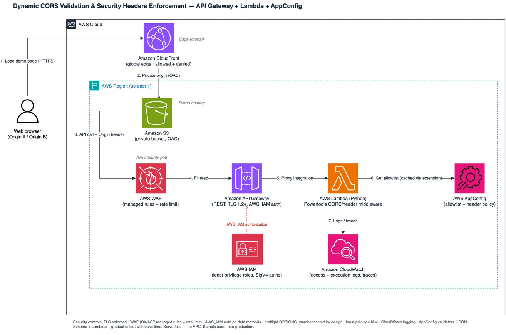

# Implementing Dynamic CORS Validation and Security Headers Enforcement for API Gateway and Lambda

Change your CORS allowlist and HTTP security-header policy **at runtime, with no
Lambda redeploy**, by driving both from **AWS AppConfig** and enforcing them in a
reusable **AWS Lambda Powertools (Python)** middleware. The API is secured by
default with **AWS_IAM** authorization, **AWS WAF**, access logging, and TLS
enforcement, following AWS security best practices.

This repository is the companion code for the AWS Prescriptive Guidance (APG)
pattern of the same name.

> **This is sample code, for non-production usage.** You should work with your
> security and legal teams to meet your organizational security, regulatory and
> compliance requirements before deployment. Deploying this content may incur AWS
> charges. Test, secure, and optimize it as appropriate for production-grade use
> based on your own quality-control practices and standards.

---

## Summary

Static, native API Gateway CORS is baked in at deploy time — changing the
allowlist means a redeploy. This pattern makes CORS **dynamic**: the allowlist
and security-header policy live in AWS AppConfig, are validated before they can
go live, roll out gradually (linear, with bake time), and are read by the Lambda
through the AppConfig extension's local cache (near-zero added latency/cost).

**Why not Lambda environment variables?** The common approach of passing the
allowlist via Lambda environment variables is static (requires a redeploy to
change), unvalidated, per-function (drifts across functions), and offers no safe
rollout. This pattern replaces that approach.

## Architecture



<sub>Text version of the request flow:</sub>

```
        Browser (Origin A allowed / Origin B not)
                    │  request + Origin header
                    ▼
        AWS WAF  ──►  API Gateway (REST, TLS 1.2+, access logs, AWS_IAM auth)
                          │  Lambda proxy integration
                          ▼
                  Lambda (Python 3.14)
                    └── @cors_and_security_headers  (Powertools middleware)
                          1. read config via AppConfig extension (local cache)
                          2. exact-match Origin against the allowlist
                          3. OPTIONS preflight → 204 + CORS headers
                          4. echo Allow-Origin ONLY on match (never "*")
                          5. inject security headers on EVERY response
                    │
                    ▼
        AWS AppConfig  (application → environment → profile)
          ├── hosted JSON: allowedOrigins[], methods, headers, securityHeaders{}
          ├── JSON Schema validator   → malformed config cannot deploy
          ├── Lambda validator        → no "*", https-only, required headers
          └── gradual deployment strategy (add a CloudWatch alarm monitor for auto-rollback)
```

## Tools

**AWS services**
- **Amazon API Gateway** — REST API entry point (AWS_IAM auth, access logs, TLS).
- **AWS Lambda** — Python 3.14 handler + AppConfig Lambda validator.
- **AWS AppConfig** — dynamic configuration store, validators, safe rollout.
- **AWS WAF** — managed common rule set + rate limiting on the stage.
- **Amazon CloudWatch Logs** — access + execution logs.
- **AWS Lambda Powertools for Python** — middleware factory, `AppConfigProvider`,
  structured Logger/Tracer.

## Repository layout

| Path | Purpose |
|---|---|
| `app.py`, `cdk.json` | CDK (Python) application entry point |
| `stacks/cors_lambda_stack.py` | All infrastructure (API GW, Lambda, AppConfig, WAF, IAM) |
| `src/api_handler/cors_middleware.py` | **Reusable** CORS + security-headers decorator |
| `src/api_handler/config_loader.py` | Reads AppConfig via the extension (cached, deny-safe) |
| `src/api_handler/handler.py` | Example business handler using the decorator |
| `src/config_validator/validator.py` | AppConfig Lambda validator (semantic rules) |
| `appconfig/cors-config.json` | The dynamic configuration (allowlist + headers) |
| `appconfig/cors-config.schema.json` | JSON Schema validator content |
| `tests/unit/` | Unit tests for the middleware and validator |
| `tests/validate_cors.sh` | End-to-end curl validation against a deployed stage |
| `ui-demo/` | Optional browser demo (allowed vs blocked origin); endpoint set in `app.js` |

---

## Prerequisites

- An active AWS account and credentials with permission to deploy these resources.
- Python 3.14+, Node.js 20+, and a **current** AWS CDK CLI
  (`npm install -g aws-cdk@latest`). Older CLIs cannot read the cloud assembly
  produced by the pinned `aws-cdk-lib` and fail with a schema-version mismatch.
- Docker **or** a local `pip` (the Lambda bundling falls back to local pip if
  Docker is unavailable — see `LocalPipBundling` in the stack).
- The target Region must have an entry in `APPCONFIG_EXTENSION_LAYER_ARNS` in
  `stacks/cors_lambda_stack.py`. Add your Region's
  [AppConfig extension layer ARN](https://docs.aws.amazon.com/appconfig/latest/userguide/appconfig-integration-lambda-extensions-versions.html)
  if it is not already listed.

## Limitations

- The CORS decision is made in the Lambda (required for *dynamic* behavior);
  native API Gateway CORS is intentionally not used.
- Config propagation is bounded by the extension poll interval + the provider
  cache TTL (`APPCONFIG_CACHE_SECONDS`, default 45s). Changes are not instant.

---

## Epics

### Epic 1 — Configure the pattern

| Task | Description |
|---|---|
| Clone and install | Clone the repo. Create a venv and `pip install -r requirements-dev.txt`. |
| Set the allowlist | Edit `appconfig/cors-config.json` — set `allowedOrigins` to your real origins (https only), adjust `allowedMethods`, `allowedHeaders`, and `securityHeaders`. |
| Confirm Region layer | Ensure your target Region is present in `APPCONFIG_EXTENSION_LAYER_ARNS`. |

### Epic 2 — Deploy the infrastructure

| Task | Description |
|---|---|
| Bootstrap | `cdk bootstrap aws://<account-id>/<region>` (first time only). |
| Deploy | `cdk deploy` (or `./deploy.sh`). Note the `ApiUrl` output. |
| Verify config deployed | In the AppConfig console, confirm the `cors-config` profile has an active deployment in the `production` environment. |

### Epic 3a — Validate security posture (cdk-nag)

The CDK app runs the **cdk-nag AWS Solutions** rule pack at synth time, so the
infrastructure is checked against AWS security best practices on every build.

| Task | Description |
|---|---|
| Run the scan | `cdk synth` — cdk-nag runs automatically. A clean synth (exit 0) means no unaddressed findings. |
| Review suppressions | The few suppressed rules are intentional design choices, each documented with evidence in `_apply_nag_suppressions` (e.g. AWS_IAM auth instead of Cognito; the unauthenticated CORS preflight; X-Ray's required `Resource:*`). |

Real findings fixed during development: request validation on the API
(`AwsSolutions-APIG2`). `AwsSolutions-L1` (latest runtime) is suppressed while
the newest Python runtime is in public preview; move to it once it is GA.

### Epic 3b — Validate behavior (curl)

| Task | Description |
|---|---|
| Run the script | `./tests/validate_cors.sh <ApiUrl> <an allowed origin> <region>` with AWS creds in the environment. Confirms: allowed origin echoed, disallowed origin blocked, security headers present, preflight returns 204. |
| **Prove it is dynamic** | Add or remove an origin in AppConfig (console → new hosted version → deploy), wait ~cache TTL, then re-run the script. Behavior flips **with no Lambda redeploy**. |

### Epic 4 — (Optional) Browser demo

| Task | Description |
|---|---|
| Set the endpoint | In `ui-demo/app.js`, set the `API_ENDPOINT` constant to your deployed `<ApiUrl>hello` URL. The endpoint is hardcoded on purpose (not user input) so the page cannot be pointed at arbitrary hosts. |
| Host the page | Serve `ui-demo/` (`index.html`, `app.js`, `styles.css`) from an origin that IS in the allowlist (e.g. an S3 + CloudFront static site), and separately from one that is NOT. |
| Observe | Click **Send preflight**. The allowlisted origin shows "CORS ALLOWED"; the other shows "CORS BLOCKED" in the browser — proving another site cannot read the API. |

### Epic 5 — Clean up

| Task | Description |
|---|---|
| Destroy | `cdk destroy --all`. Confirm the stacks and their log groups are removed. |
| If the demo stack fails to delete | CloudFront delivers access logs with a delay, so new log files can land in the demo logs bucket after it was emptied, and deletion fails with "bucket is not empty". Empty it with `aws s3 rm s3://<UiLogsBucket name> --recursive`, then re-run `cdk destroy UiDemoStack`. |
| KMS key | The key is scheduled for deletion with a 7-day waiting period; it is not removed immediately. |

---

## Security considerations

- **No open API** — every data method requires `AWS_IAM`; closes the Security Hub
  "API Gateway without authorization" exposure. OPTIONS is unauthenticated only
  because browsers cannot sign a preflight; it returns no data.
- **No secrets in env vars** — only non-sensitive AppConfig coordinates are in
  the Lambda environment; the allowlist/policy live in AppConfig.
- **No credentialed wildcard** — the middleware never emits `*`, and never pairs
  `Access-Control-Allow-Credentials: true` with a wildcard.
- **Deny-safe** — if AppConfig is briefly unreachable and the cache is cold, the
  loader denies all origins rather than failing open.
- **Least-privilege IAM** — the handler role may read only this one AppConfig
  profile ARN.
- **Defense in depth** — WAF managed rules + rate limiting, access + execution
  logging, and TLS enforced via an API resource policy.
- **Safe config changes** — JSON Schema + Lambda validators block bad config
  before rollout; the gradual deployment strategy limits blast radius.
- **CORS is not authorization** — CORS is browser-enforced and only limits which
  web origins may *read* responses; access control to the API is provided by
  AWS_IAM.

## Local development

```bash
python3 -m venv .venv && source .venv/bin/activate
pip install -r requirements-dev.txt
pytest tests/unit -q          # unit tests for middleware + validator
cdk synth                     # synthesize the CloudFormation template
```

## Security

See [CONTRIBUTING](CONTRIBUTING.md#security-issue-notifications) for how to report a security issue.

## License

This library is licensed under the MIT-0 License. See the [LICENSE](LICENSE) file.
